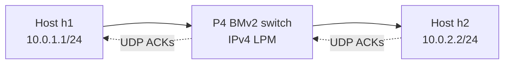
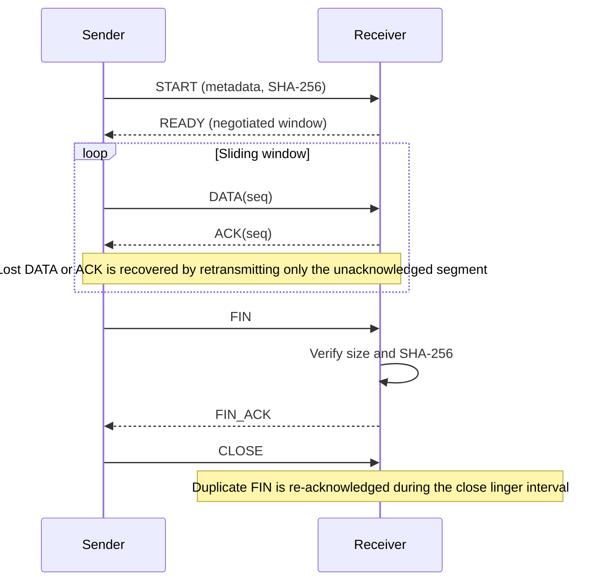

# Architecture

## System overview

The repository contains two components joined by a reproducible Mininet topology:

- A P4_16 IPv4 forwarding program executing on BMv2.
- An application-layer Selective Repeat transport implemented over UDP.

## P4 processing pipeline

The program in `p4src/main.p4` targets BMv2 v1model.

1. Parse Ethernet and, when applicable, IPv4 and TCP.
2. Verify the IPv4 header checksum.
3. For TCP packets, hash `(IPv4 source, IPv4 destination, TCP destination port)` using CRC-16 and CRC-32 into two register indices.
4. Increment the two 32-bit register counters.
5. Drop a TCP packet if both updated counters exceed `FLOW_PACKET_THRESHOLD`.
6. Otherwise, apply IPv4 LPM forwarding.
7. Rewrite both Ethernet source and destination MAC addresses for the egress subnet, decrement TTL, recompute the IPv4 header checksum, and deparse.

The two counters behave like a small count-min-style approximate frequency structure. Collisions may overestimate a key's packet count. It is not a Bloom filter.

### Forwarding topology

The supplied Mininet topology uses two IP subnets to exercise the LPM path:

| Node | IP address | Default gateway |
|---|---|---|
| h1 | 10.0.1.1/24 | 10.0.1.254 |
| h2 | 10.0.2.2/24 | 10.0.2.254 |

The hosts install static ARP entries for the gateway MAC addresses. The switch is programmed with two host routes:

- `10.0.2.2/32` to h2's MAC address on switch port 2, using the router MAC for subnet 2 as Ethernet source.
- `10.0.1.1/32` to h1's MAC address on switch port 1, using the router MAC for subnet 1 as Ethernet source.

Static ARP is intentional: the P4 parser does not implement ARP learning or forwarding.

## Selective Repeat protocol

`src/selective_repeat/protocol.py` defines a versioned datagram format with session IDs and CRC-32 validation. `sender.py` maintains per-segment timers and a selective acknowledgement set. `receiver.py` buffers out-of-order segments, commits only contiguous data, verifies the final file digest, and atomically moves the completed file into place.

The transfer is application-layer UDP, not TCP. The BMv2 counter only processes TCP packets, so Selective Repeat UDP segments are forwarded by the IPv4 LPM table without incrementing that TCP-specific counter.

## Experiment flow

1. Compile the P4 source to a BMv2 JSON pipeline.
2. Start Mininet with one BMv2 switch and two hosts on different subnets.
3. Install static ARP and IPv4 LPM entries.
4. Run a ping smoke test.
5. Start the Selective Repeat receiver on h2 and sender on h1.
6. Record the sender's JSON statistics and the tool/topology configuration used.

The topology script does not invent throughput measurements or silently run an experiment in CI. See [reproducibility.md](reproducibility.md).
