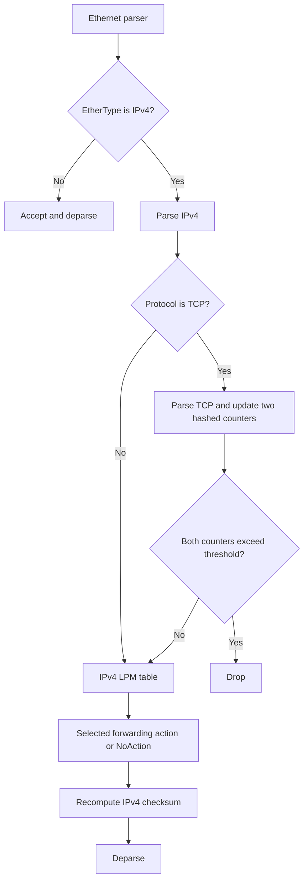

# Architecture and implementation notes

## P4 pipeline

The P4 program in `p4src/main.p4` uses the BMv2 `v1model` architecture and defines the following path:

The parser extracts Ethernet, IPv4, and TCP headers. Other EtherTypes and non-TCP IPv4 packets are accepted without TCP-specific processing.

### Approximate packet counter

For each IPv4/TCP packet, the program hashes this key:

`(IPv4 source address, IPv4 destination address, TCP destination port)`

Two different CRC hash algorithms select register indices. The corresponding 32-bit counters are incremented. The packet is dropped if **both updated counter values are greater than 1,000**.

This is a two-hash approximate frequency counter with count-min-style query behavior. It can overestimate a key's frequency because unrelated keys may collide in the same registers. It is not a membership Bloom filter: the registers store counters, not inserted-item bits.

Important implementation properties:

- The key omits the TCP source port, so it is not a five-tuple flow identifier.
- Counters are 32-bit and have no saturation or reset logic in the data plane.
- Register read/modify/write behavior and atomicity depend on the target implementation.
- The code does not emit an ICMP response when it drops a packet.

### Forwarding

The `ipv4_lpm` table performs longest-prefix-match lookup on the destination IPv4 address. The table has a `NoAction` default, so a deployment must install the appropriate entries through its control plane before expecting configured forwarding behavior.

The forwarding action decrements TTL and rewrites Ethernet addresses. The project does not currently include a runtime controller or a topology configuration, so those operational details are not automated or validated here.

### Checksums

The pipeline verifies and recomputes the IPv4 header checksum. It does not verify or recompute the TCP checksum; the current ingress logic does not modify TCP header fields.

## Selective Repeat launcher

`scripts/run_selective_repeat.py` is orchestration only. It starts an external receiver script and then an external sender script, passing the destination host and port to the sender. Neither endpoint is included in the repository. See [selective-repeat.md](selective-repeat.md) for the interface contract.
